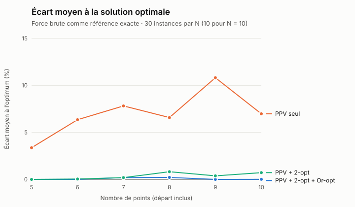
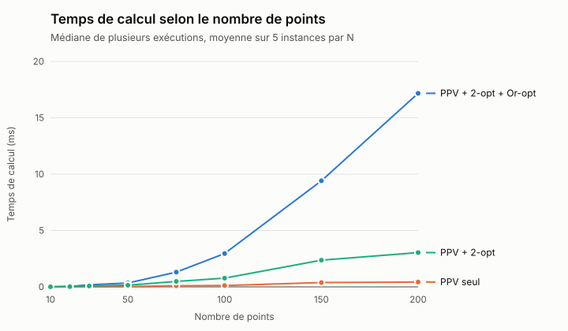
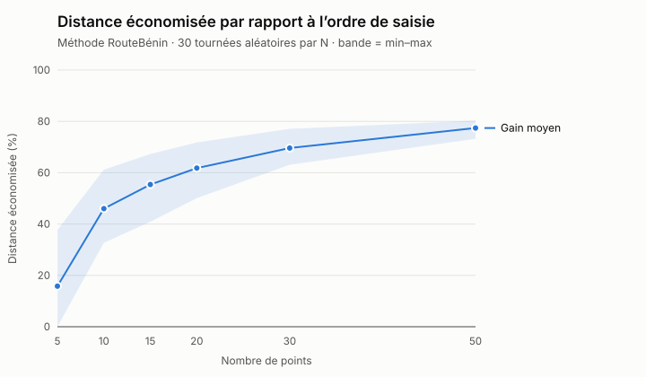

# Benchmarks du moteur d'optimisation

> Fichier généré par `npm run bench` (dossier `server/`) le 2026-11-06 — Node v22.11.0.
> Ne pas modifier à la main : relancer le script.

**Protocole.** Instances = points aléatoires (générateur à graine fixe, donc
reproductibles) dans l'emprise Cotonou / Abomey-Calavi ; distances Haversine.
Les trois variantes exécutent **le code même de l'application**
(`server/src/algorithms/tsp.ts`) :

| Variante | Description |
|---|---|
| Plus Proche Voisin seul | construction gloutonne, O(n²) |
| PPV + 2-opt | + décroisement des segments jusqu'à stabilité |
| **PPV + 2-opt + Or-opt (RouteBénin)** | + déplacement de points isolés, alterné avec 2-opt |

## 1. Qualité : écart à l'optimum exact

Référence = **force brute** (toutes les (n−1)! permutations).

| N | Instances | PPV + 2-opt + Or-opt — écart moyen / max | PPV seul — écart moyen / max | PPV + 2-opt — écart moyen / max | Optimum atteint (RouteBénin) |
|---|---|---|---|---|---|
| 5 | 30 | 0 % / 0 % | 3,37 % / 24,6 % | 0 % / 0 % | 100 % |
| 6 | 30 | 0 % / 0 % | 6,35 % / 21,6 % | 0,04 % / 1,31 % | 100 % |
| 7 | 30 | 0,19 % / 2,96 % | 7,82 % / 35,75 % | 0,19 % / 2,96 % | 93 % |
| 8 | 30 | 0,21 % / 2,75 % | 6,58 % / 16,7 % | 0,82 % / 9,99 % | 90 % |
| 9 | 30 | 0 % / 0 % | 10,82 % / 32,5 % | 0,38 % / 5,5 % | 100 % |
| 10 | 10 | 0,01 % / 0,14 % | 6,98 % / 12,77 % | 0,72 % / 6,17 % | 90 % |

## 2. Temps de calcul

| N | PPV + 2-opt + Or-opt (ms) | PPV seul (ms) | PPV + 2-opt (ms) | Gain de la méthode complète vs PPV seul |
|---|---|---|---|---|
| 10 | 0,01 | 0 | 0,01 | 8,03 % |
| 20 | 0,04 | 0,01 | 0,02 | 17,42 % |
| 30 | 0,18 | 0,02 | 0,08 | 10,9 % |
| 50 | 0,34 | 0,03 | 0,15 | 13,5 % |
| 75 | 1,31 | 0,1 | 0,49 | 16,99 % |
| 100 | 2,96 | 0,12 | 0,77 | 12,44 % |
| 150 | 9,41 | 0,38 | 2,37 | 14,98 % |
| 200 | 17,17 | 0,43 | 3,04 | 17,08 % |

## 3. Gain par rapport à l'ordre de saisie

C'est le chiffre affiché à l'utilisateur (« Avant → Après »). L'ordre de saisie
est ici aléatoire ; un livreur qui saisit ses adresses « au hasard » obtient
ce type de gain.

| N | Gain moyen | Min | Max |
|---|---|---|---|
| 5 | 15,8 % | 0 % | 37,7 % |
| 10 | 46 % | 32,7 % | 61,2 % |
| 15 | 55,4 % | 40,9 % | 67,3 % |
| 20 | 61,8 % | 50,1 % | 71,8 % |
| 30 | 69,6 % | 63,1 % | 77,1 % |
| 50 | 77,4 % | 73,2 % | 80,3 % |

## 4. Multi-livreurs : deux critères de répartition

30 instances par ligne (21 points, distances Haversine, donc sans
durées). **Charge** d'un livreur = distance + 2 km par arrêt (≈ 5 min de
livraison en ville). Dans l'application, avec les durées OSRM, la charge est
mesurée en **temps** : conduite + 5 min par livraison.
« Même nombre d'arrêts » minimise la distance totale avec au plus ⌈n/K⌉ arrêts
par livreur ; « charges équilibrées » minimise Σ charge² (= K·(moyenne² + variance)).

| Scénario | K | Critère | Distance totale | Charge max | Écart max − min | Gain vs partage naïf | Temps |
|---|---|---|---|---|---|---|---|
| 20 adresses en ville | 2 | Même nb d’arrêts | 67,6 km | 57,7 km | 7,9 km | 59,7 % | 10 ms |
| 20 adresses en ville | 2 | **Charges équilibrées** | 66,4 km | 57,8 km | 9,2 km | 60,4 % | 20,1 ms |
| 20 adresses en ville | 3 | Même nb d’arrêts | 79,5 km | 45,5 km | 12,4 km | 54,5 % | 7,6 ms |
| 20 adresses en ville | 3 | **Charges équilibrées** | 78,1 km | 45,9 km | 13,9 km | 55,4 % | 18 ms |
| 20 adresses en ville | 4 | Même nb d’arrêts | 93,9 km | 40,3 km | 13,8 km | 46,9 % | 5,9 ms |
| 20 adresses en ville | 4 | **Charges équilibrées** | 90 km | 41 km | 17,3 km | 49,1 % | 20,5 ms |
| 20 adresses + 1 point isolé (type Porto-Novo) | 2 | Même nb d’arrêts | 104,5 km | 91,4 km | 36,3 km | 51,9 % | 6,2 ms |
| 20 adresses + 1 point isolé (type Porto-Novo) | 2 | **Charges équilibrées** | 103,6 km | 82,1 km | 18,6 km | 52,4 % | 21,5 ms |
| 20 adresses + 1 point isolé (type Porto-Novo) | 3 | Même nb d’arrêts | 118,2 km | 79,3 km | 42,1 km | 46,7 % | 7,1 ms |
| 20 adresses + 1 point isolé (type Porto-Novo) | 3 | **Charges équilibrées** | 117,7 km | 70 km | 29,5 km | 46,9 % | 22 ms |
| 20 adresses + 1 point isolé (type Porto-Novo) | 4 | Même nb d’arrêts | 127,4 km | 73,3 km | 51,5 km | 44,4 % | 9,3 ms |
| 20 adresses + 1 point isolé (type Porto-Novo) | 4 | **Charges équilibrées** | 126,2 km | 63,6 km | 36,3 km | 44,9 % | 27,9 ms |

## Lecture pour le mémoire

- Le **PPV seul** est rapide mais s'éloigne de l'optimum dès quelques points.
- **2-opt** supprime l'essentiel de cet écart ; **Or-opt** corrige les cas
  résiduels qu'un simple décroisement ne voit pas.
- Le temps de calcul reste **bien en dessous de la milliseconde** pour une
  tournée réaliste (10 à 30 points), et de l'ordre de 15 ms à 200 points. Il
  croît de façon polynomiale, sans l'explosion factorielle de la force brute.
  L'utilisateur attend surtout les appels OSRM, pas l'algorithme.
- La méthode complète n'est pas exacte (heuristique) : elle rate parfois
  l'optimum de quelques dixièmes de pourcent — à comparer au coût de la force
  brute, inutilisable au-delà d'une dizaine de points.

- En multi-livreurs, les deux critères battent largement le partage naïf.
  **Avec un point isolé**, « charges équilibrées » allège le livreur le plus
  chargé d'environ 8 à 10 km et réduit l'écart entre livreurs de 30 à 50 %,
  pour une distance totale égale ou inférieure. **En ville homogène**, le
  plafond ⌈n/K⌉ équilibre déjà bien : « charges équilibrées » y raccourcit la
  distance totale (−1 à −4 km) au prix d'un écart un peu plus grand. Σ charge²
  arbitre entre efficacité (moyenne) et équité (variance) ; ce n'est pas un
  critère min-max strict.

Données brutes : `resultats.json`, `qualite.csv`, `temps.csv`, `gain.csv`, `vrp.csv`.
